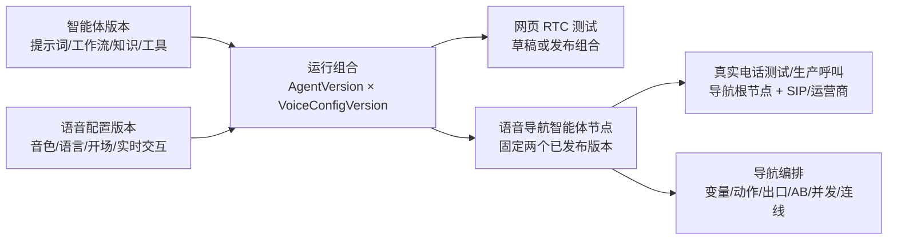

# 智能体语音配置迁移与网页/电话测试需求说明

## 1. 文档信息

- 对应原型：`index.html`
- 交付范围：智能体搭建页中的语音配置、网页 RTC 测试、真实电话测试入口及测试记录示意
- 原型性质：交互验证稿；按钮、通话、麦克风、保存、发布均为模拟，不连接生产服务

## 2. 背景与目标

当前语音导航的智能体节点（类型 24）同时承载智能体绑定、音色与交互体验、变量、动作、出口和并发等配置，导致智能体能力与呼叫编排耦合。用户只有完成语音导航及号码配置后，才能听到智能体真实语音效果。

本期目标是：

1. 将属于智能体定义与语音体验的配置迁入智能体搭建页。
2. 将语音配置建设为企业级、可独立版本化、可跨智能体复用的资产；智能体版本与语音配置版本自由组合，不形成从属关系。
3. 在智能体搭建页提供统一“测试”入口，覆盖网页 RTC 快速测试和真实电话链路测试。
4. 保留语音导航节点作为真实呼叫编排对象，避免在智能体平台复制 AB、出口、动作、并发等呼叫侧模型。
5. 网页和电话测试都能进入评测与记录体系，但必须按来源隔离话单、计费和报表口径。
6. 在语音导航未下线的过渡期，形成“智能体搭建配置主要内容 → 带参跳转语音导航 → 完成节点连线与呼叫侧配置”的短链路。

### 2.1 新架构一图

核心变化不是把整个语音导航搬走，而是拆成三类对象：智能体资产、语音配置资产、呼叫编排。前两类在智能体搭建独立版本化，语音导航节点只保存明确的生产组合并负责真实电话路由。

## 3. 调研结论

### 3.1 Retell 逻辑的取舍

借鉴：

- Voice、Language 等高频配置处于智能体编辑上下文；复杂语音参数按任务分组并折叠，需要时再展开。
- 草稿可以先测试，发布后形成只读版本；历史版本可比较、复制并生成新草稿。
- Web Call 默认复用当前智能体配置，同时允许动态变量、Mock 工具和本次会话覆盖。
- 测试入口与配置编辑相邻，降低“改完再找入口”的成本。

不照搬：

- 现网已有语音导航、SIP、Asterisk/AudioSocket 和呼叫话单，不将生产呼叫编排搬到智能体平台。
- 网页 RTC 与电话 SIP 是两条媒体路径；前端可以统一入口，后端不能假设两者协议相同。

### 3.2 会议与呼叫侧约束

- 网页测试用于验证配置、语音体验和基础功能；无法代替运营商链路中的音质损耗和时延验证。
- 电话测试必须走 SIP 与真实运营商链路，推荐使用专用测试号码；测试号码不与某条导航永久绑定。
- 电话测试需要选择一个“呼叫绑定”（语音导航 + 类型 24 节点路径），并从导航根节点进入。
- 测试通话落现有内部话单，增加来源、导航、节点路径、智能体版本等标识；不混入企业正式推送、IVR 正式报表和机器人正式报表。
- 测试链路可能触发真实副作用，开始前必须展示转人工、直呼、短信、工单、外部调用等清单并二次确认。

## 4. 信息架构与入口

### 4.1 智能体搭建

左侧一级导航保持：

- 编排
- 测评
- 日志

智能体搭建存在两层信息架构：

1. 产品能力层：智能体、工作流、知识库、工具、记忆。
2. 进入某个智能体后的单智能体工作区：编排、语音配置、测评、日志。

本期把“语音配置”放在第二层，与编排、测评、日志并列。它不属于“编排”内部页签，也不进入第一层产品能力导航。原因是用户主要在当前智能体上下文里选择和测试语音组合，但底层 VoiceConfig 是企业级独立资产，拥有自己的版本线并可跨智能体复用。

顶部固定提供：

- 当前草稿/发布状态
- 版本历史
- 测试
- 发布

原型顶部另设“智能体搭建 / 语音导航”场景切换器，仅用于演示跨平台链路，不是正式产品导航。

### 4.2 测评

“测评”聚合三类能力：

- 文本评测：沿用评测中心现有能力。
- 网页语音测试：进入与顶部“测试”相同的抽屉，并默认选中网页通话。
- 真实电话测试：进入相同抽屉，并默认选中电话测试。

### 4.3 日志

“日志”增加测试记录视图，按网页 RTC、电话呼入、电话外呼区分来源。网页记录使用 TestSession ID；电话记录使用呼叫话单 ID。

## 5. 配置迁移边界与页面收敛

### 5.1 首屏仅保留关键配置

语音配置页不再平铺全部底层参数。首屏控制在 6 类高频操作内：

| 首屏配置 | 原因 |
|---|---|
| 智能体版本 × 语音配置版本 | 明确本次编辑/测试组合，避免隐式绑定 |
| 音色与试听 | 最常调整，结果可直接感知 |
| 语言 | 影响识别和合成，属于关键选择 |
| 开场方式 | 直接影响首轮体验 |
| 语速 | 高频体验参数 |
| 响应速度、打断灵敏度 | 直接决定实时对话手感 |

### 5.2 高级配置

高级配置默认折叠，标题展示“已采用推荐最佳参数”和异常项数量。参数均由平台按语言、音色供应商和场景给出推荐默认值，用户通常无需打开。

高级配置包括：ASR 引擎、静音停顿、沉默等待、背景音、最大轮次、追问次数、聆听反馈、噪声过滤、异常超时与兜底、供应商扩展参数等。只有改动项才在折叠标题和发布差异中突出显示，并提供“一键恢复推荐值”。

### 5.3 迁入智能体平台

| 配置域 | 字段/能力 | 说明 |
|---|---|---|
| 语音资产 | TTS 供应商、音色、语言、语速、音调、音量、供应商扩展参数 | 进入 VoiceConfigVersion，独立于智能体版本 |
| 识别 | ASR 引擎、识别语言、热词引用 | 进入 VoiceConfigVersion 的高级配置 |
| 对话启动 | 固定/模型开场白、接通延时、优先播报 | 网页测试默认复用 |
| 播放体验 | 背景音、背景音量 | 属于智能体语音体验 |
| 交互体验 | 响应速度、打断灵敏度、静音停顿、沉默等待、追问方式与次数、轮次上限 | 进入 VoiceConfigVersion |
| 体验优化 | 聆听反馈、回复优化、语气承接、抗打断 | 作为智能体全局能力 |
| 异常兜底 | 未回复超时、最大提示次数、提示内容 | 进入 VoiceConfigVersion 的高级配置 |

### 5.4 保留在语音导航/呼叫侧

| 配置域 | 字段/能力 | 原因 |
|---|---|---|
| 路由绑定 | agentId、agentVersionId、voiceConfigId、voiceConfigVersionId | 决定真实来电使用的生产组合 |
| AB | 实验组、分流比例、每组版本绑定 | 属于呼叫编排 |
| 变量 | 通道变量、上游变量、变量提取 | 与导航上下文相关 |
| 动作/出口 | 转人工、挂断、未匹配、沉默超时、响应超时、超并发 | 决定呼叫走向 |
| 呼叫控制 | 并发、直呼、短信、DTMF、线路、号码 | 智能体平台不复制 |

原则：同一字段只能有一个编辑源。智能体平台可只读展示呼叫绑定摘要并跳转，但不能再次编辑呼叫侧字段。

## 6. 智能体版本与语音配置版本

### 6.1 对象

- Agent：智能体稳定身份。
- AgentVersion：智能体提示词、工作流、知识与工具等的一次版本；草稿可编辑，发布后不可变。
- VoiceConfig：企业内稳定的语音配置身份，可被多个智能体复用。
- VoiceConfigVersion：音色、语言、开场和实时交互参数的一次版本；草稿可编辑，发布后不可变。
- RuntimeBinding：一个明确的 `AgentVersion × VoiceConfigVersion` 组合；网页测试临时生成，生产由语音导航节点固定保存。

### 6.2 规则

- 智能体版本与语音配置版本分别创建、保存、发布和回滚；任何一方不包含另一方的完整快照。
- 两者是多对多关系。语音配置允许企业内跨智能体复用，禁止跨企业引用。
- 网页测试可选择有权限的草稿或已发布版本自由组合。
- 生产语音导航只能选择两个已发布版本，且必须保存明确版本 ID，禁止使用 `latest`。
- 任一资产发布新版本后，仅提示升级，不自动改变已有导航节点。
- 被导航节点、通话或测试会话引用的版本只能归档，不能物理删除。

### 6.3 为什么不把语音版本固化进智能体版本

如果 AgentVersion 内固定引用 VoiceConfigVersion，同一个智能体版本为了试不同音色就必须复制多个智能体版本，跨智能体复用也会形成升级连锁。本方案把两条版本线拆开，仅在运行时和导航节点上选择组合，既能独立回滚，也能复用同一语音配置。

## 7. 过渡方案：保留语音导航

### 7.1 用户路径

1. 在智能体搭建完成提示词、流程等智能体内容，创建或选择智能体版本。
2. 在同一智能体工作区的“语音配置”完成主要语音内容，创建或选择语音配置版本。
3. 网页测试可直接选择两个草稿/发布版本组合验证效果。
4. 准备接入真实电话时，发布两个版本，点击“去语音导航配置节点”。
5. 系统携带 `agentId + agentVersionId + voiceConfigId + voiceConfigVersionId` 跳到目标导航；可定位已有类型 24 节点，也可新建节点。
6. 语音导航节点自动回填两个版本；用户继续配置通道变量、变量提取、动作、异常出口、AB、并发和节点连线。
7. 保存导航后，语音配置页和电话测试页回显导航名称、节点路径、环境与生产组合。

### 7.2 改造后的语音导航节点

节点面板分成两块：

- 运行绑定：智能体、智能体版本、语音配置、语音配置版本。数据来自智能体平台；生产只展示已发布版本。
- 导航编排：变量、动作、出口、AB、并发和连线，继续由呼叫侧编辑。

旧节点中的音色/ASR/交互参数迁移为 VoiceConfigVersion。过渡期可保留只读兼容字段和迁移状态，但不得继续双写；修改按钮统一跳转智能体搭建。

### 7.3 回显规则

- 语音配置页：展示“被哪些导航节点引用”，可跳转定位。
- 网页测试：可展示导航回显供追溯，但 RTC 不依赖导航即可运行。
- 电话测试：必须选择一个有效导航绑定，展示导航、节点路径和两个生产版本。
- 语音导航：展示来源智能体/语音配置和最近同步时间，可返回对应配置页。

## 8. 网页 RTC 测试

### 8.1 默认行为

- 默认选择当前智能体草稿 × 当前语音配置版本。
- 默认复用选中语音配置中的 ASR、TTS、开场白和交互配置，不先复制一份 Mock 配置。
- 创建会话时冻结一次性测试快照，保证测试过程中保存草稿不会改变当通。

### 8.2 仅本次覆盖

允许：

- 临时调整音色、语速、音调、音量。
- 填写动态变量。
- 指定智能体内部起始节点。
- 将工具调用设为真实或 Mock。

规则：

- 覆盖项必须标记“仅本次”，不得自动写回草稿。
- 会话结束后可展示 Diff，并由用户主动选择“应用到草稿”。
- 从中间节点开始时，必须列出缺失的上游变量；缺失必填变量时阻止开始。

### 8.3 链路与记录

1. 智能体平台冻结测试快照。
2. TestSession 解析最终配置并签发一次性 RTC 凭证。
3. 浏览器通过 WebRTC 与测试媒体通道对话。
4. 页面展示实时转写、节点轨迹、工具事件、打断与延迟。
5. 结束后保存 TestSession、组合配置哈希、智能体版本、语音配置版本、转写、轨迹和结束原因。

网页测试不建 SIP、不占线路分钟；是否占企业音频并发按呼叫侧最终合同执行。页面不出现号码、线路、外显和呼入/外呼方向。

## 9. 真实电话测试

### 9.1 共同前置条件

- 仅测试已发布智能体版本 × 已发布语音配置版本。
- 智能体已在目标呼叫集群登记并可调起。
- 必须选择呼叫绑定：语音导航、类型 24 节点路径。
- 开始前完成未保存检查和真实副作用确认。

### 9.2 呼入

- 用户点击“获取测试号”，系统分配空闲专用测试号。
- 等待时长 120 秒；来话后绑定测试会话，从导航根节点执行。
- 等待阶段不产生 mainUniqueId；接通后才进入真实通话态。
- 同一号码同一时刻只能有一个等待会话；关闭抽屉需释放等待位。

### 9.3 外呼

- 用户填写被叫号码。
- 外显由呼叫侧配置唯一测试外显，页面不可选择。
- 走现网黑名单、频次、禁呼校验，并计入被叫正式频次。
- 通过单通测试外呼接口发起，不复用 WebCall 或批量外呼任务。

### 9.4 话单与计费

- 落现有内部话单，不新建话单表。
- 新增或补齐测试来源、导航 ID、节点路径、智能体版本/快照、本通 botId 等标识。
- 电话比网页多号码、线路、方向和线路分钟字段。
- 号码月租、中继线路分钟、企业并发与智能体用量沿用现网规则；不新增账单科目。

## 10. 测试抽屉状态

| 状态 | 配置 | 主按钮 | 可切通道/绑定 | 对话区 |
|---|---|---|---|---|
| 未开始 | 展开 | 开始网页通话/获取测试号/发起外呼 | 可以 | 空态 |
| 确认中 | 保持 | 禁用 | 不可以 | 保持 |
| 正在连接 | 保持 | 正在连接 | 不可以 | 状态提示 |
| 等待来电 | 保持 | 取消等待 | 不可以 | 等待提示，不出转写 |
| 通话中 | 收起 | 挂断 | 不可以 | 实时逐句追加 |
| 已结束 | 可展开 | 再测一次 | 可以 | 保留上一通转写 |

关闭规则：未开始/已结束直接关闭；等待来电时关闭先释放等待位；连接或通话中关闭必须二次确认并挂机。

## 11. 对话与结果展示

- 智能体气泡靠左，用户/客户气泡靠右。
- 每句展示角色、文本、时间；被打断半句显示“已打断”。
- 用户停留底部时自动滚动；上翻后不强制回底，提供“回到最新”。
- 电话链路失败、拒接、空号、超并发等原因显示在状态条和测试记录中。
- 遇到转人工、短信、直呼、DTMF 等真实呼叫动作，网页 RTC 只记录动作，不伪装为执行成功；电话测试按确认后的真实链路执行。

## 12. 接口建议

### 12.1 智能体与语音配置

- AgentVersion 草稿保存、发布、版本列表、版本比较。
- VoiceConfig/VoiceConfigVersion 列表、创建草稿、发布、版本比较、使用方查询。
- RuntimeBinding 解析：输入两个版本 ID，校验企业、权限、状态与兼容性，返回运行快照。
- NavigationReference 查询：按智能体或语音配置读取导航、节点路径、环境和固定版本。

### 12.2 网页测试

- `POST /rtc-test-sessions/resolve-preview`：校验变量、起始节点和最终配置。
- `POST /rtc-test-sessions`：冻结测试快照并签发短时 RTC 凭证。
- `POST /rtc-test-sessions/{id}/end`：结束测试。
- `GET /rtc-test-sessions/{id}`：读取结果。
- WebSocket/SSE：状态、转写、节点、工具、打断事件。

### 12.3 电话测试

- 创建/取消呼入等待会话。
- 创建单通测试外呼。
- 结束测试通话。
- 测试话单查询与详情。

浏览器不得获得长期 API Key、TTS 密钥或 RTC 服务端密钥，只接收绑定单次会话的短时凭证。

## 13. 错误与阻断文案

| 场景 | 建议文案 |
|---|---|
| 智能体未登记 | 当前智能体未在呼叫侧登记，不能进行电话测试 |
| 没有呼叫绑定 | 请先选择语音导航和智能体节点 |
| 草稿发起电话测试 | 电话测试仅支持已发布版本，请先发布或选择历史发布版本 |
| 麦克风拒绝 | 需要麦克风权限才能进行网页通话 |
| RTC 失败 | 连接失败，请检查网络与音频设备 |
| 企业通道已满 | 企业通道已满 |
| 企业音频通道已满 | 企业音频通道已满，同企业正式电话也可能无法进入智能体节点 |
| 测试号占用 | 测试号占用，请稍后重试 |
| 未配置测试外显 | 未配置测试外显，无法外呼 |
| 缺少上游变量 | 当前起始节点缺少必填变量，请补充后再测试 |

## 14. 验收标准

### 14.1 配置与版本

- 首屏只展示关键配置，高级参数默认折叠且具备推荐默认值和恢复能力。
- 用户能分别管理智能体版本与语音配置版本，并在测试/导航节点选择组合。
- 语音配置可以在同一企业内跨智能体复用，并独立版本化。
- 新智能体版本或新语音配置版本都不会自动改变生产导航绑定。
- 用户可从语音配置带参跳转到语音导航，完成节点连线后在两侧看到可追溯回显。
- 呼叫侧字段在智能体平台只读展示，不形成第二套编辑源。

### 14.2 网页测试

- 草稿无需发布即可测试；默认复用当前草稿配置。
- 本次覆盖不自动写回草稿；结束后可通过 Diff 主动应用。
- 通话中可看到状态、转写、节点轨迹与关键事件。
- 网页页面不出现号码、外显、线路或呼入/外呼字段。

### 14.3 电话测试

- 只有已发布版本且存在有效呼叫绑定时可开始。
- 呼入测试号、等待、接通、超时、取消和释放状态正确。
- 外呼校验、外显、正式频次与线路计费沿用现网。
- 测试话单可按来源、导航、节点路径、版本和通话 ID 检索。

### 14.4 隔离与安全

- 测试数据不进入企业正式推送、IVR 正式报表和机器人正式报表。
- 测试会话、真实呼叫和正式来电互不覆盖配置。
- 电话测试真实副作用在创建会话前明确展示并由用户确认。

## 15. 原型交互说明

- 默认打开当前智能体工作区的“语音配置”；它与“编排、测评、日志”同级。
- 点击顶部“测试”打开统一测试抽屉。
- 可切换“网页通话 / 电话测试”，电话下可切换“呼入 / 外呼”。
- 网页测试可展开“仅本次覆盖”，点击开始后模拟连接和实时转写。
- 呼入测试先分配专用测试号，再点击底部按钮模拟来电接通。
- 点击“更换”可选择企业共享语音配置版本。
- 左侧“编排、语音配置、测评、日志”用于验证单智能体工作区的二级信息架构。
- 点击原型顶部“智能体搭建 / 语音导航”切换两个产品场景。
- 点击“高级配置”展开低频参数；默认展示推荐值。
- 点击“去语音导航配置节点”可带入当前组合并定位节点。
- 在语音导航场景可验证运行绑定、节点编排和双向返回关系。

## 16. 参考资料

- 既有方案：《语音导航智能体节点迁移与 RTC 网页测试需求分析》
- 呼叫侧需求：《【内部自提】语音导航页面支持网页测试/电话测试/（机器人对练）》
- 会议听记：《高斌发起的视频会议》，2026-11-12，完整逐字稿 4 页/363 段
- 现网截图：语音导航类型 24 节点配置、智能体搭建页
- 视觉参考：<https://will-mojave.github.io/prototypes/agent-eval-loop/>
- Retell：[Global settings](https://docs.retellai.com/build/conversation-flow/global-setting)、[Agent versions](https://docs.retellai.com/agent/version)、[Web call testing](https://docs.retellai.com/test/test-web)
